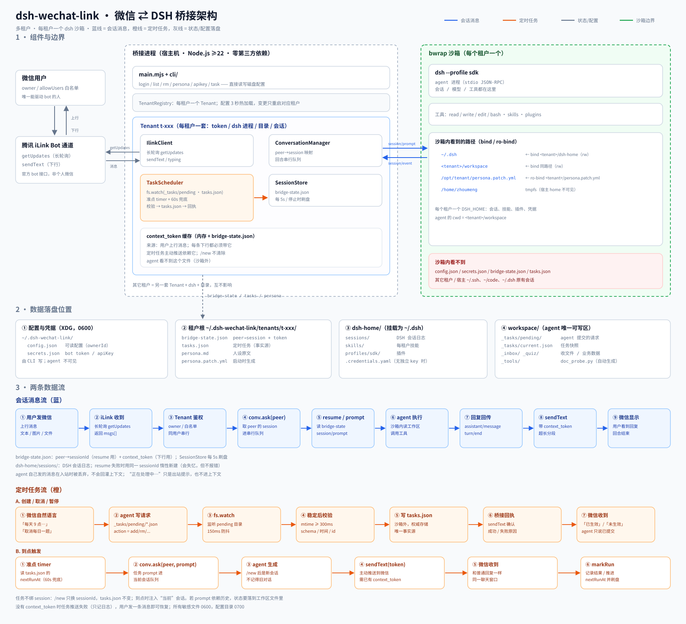

# dsh-wechat-link

把微信（腾讯 iLink 官方 Bot 通道）接入 [DeepSeek Harness](https://github.com/deepseek-ai/deepseek-harness) 的多租户桥接：在微信里发消息，DSH 的 agent 处理，结果回到微信。


> **状态：0.1.0，实验阶段。** 真实微信扫码登录与消息往返已验证；npm 包尚未发布，目前从源码安装。生产使用前请先读 [安全模型](#安全模型) 和 [已知限制](#已知限制)。

## 它能做什么

- **多租户**：一台机器跑多个互不影响的 bot；运行中扫码即可新增，单个租户故障不影响其它租户。
- **微信对话**：文本、图片、文件、引用消息、语音转写；长回复自动分段。
- **图片**：下载解密、大图压缩、BMP/TIFF/HEIC/AVIF 转码，原图留存；送入支持视觉的模型。
- **文件**：落盘到工作区，只给路径/类型/大小；内置 `doc_probe.py` 按需探测 PDF/XLSX/DOCX/CSV，扫描件自动 OCR。
- **链接**：抓取正文并落盘；SSRF 防护；同一会话重复链接只注入路径。
- **定时任务**：一次、每天、每周、固定间隔；到点由 agent 生成内容并主动推送。
- **主动发媒体**：agent 生成图片/文件后，用 `[[image:]]` / `[[file:]]` 发回微信。
- **每 bot 独立**：persona、技能、插件、模型和 API key 都可单独配置。
- **运维**：`/status`、`/usage`、用量/预算、健康检查、systemd、Docker/K8s、单文件 SEA。
- **隔离**：默认 bwrap 沙箱；容器模式用容器作为边界。

## 平台限制：一人一 bot

iLink bot 在微信里是插件形态，只支持 **1 对 1 私聊**；协议没有群聊、邀请好友或分享 bot 的接口。

- ❌ 不能让多个微信账号共用一个 bot
- ✅ 每个人在同一台机器上扫码，得到自己的 bot（这就是多租户做的事）
- 需要“多人群聊里共用 agent”时，iLink 这条路走不通，应改用企业微信。

## 架构



> 蓝线是会话消息，橙线是定时任务，灰线是状态/配置落盘，绿线是沙箱边界；每个租户一套 dsh 进程 + 目录 + 会话。

- `Tenant` 负责入站队列、访问控制、媒体落盘、任务、出站发送和会话映射。
- `AgentSession` 负责拉起/重启本租户的 dsh、注入 persona、维护 `context_token`。
- `dsh` 在 bwrap 沙箱里运行（容器模式除外），只能读写本租户的工作区和 dsh-home。
- 每个租户一套 `tenantRoot` + `workspace` + `dsh-home`，互不可见。

## 前置条件

| 组件 | 要求 |
|---|---|
| Node.js | ≥ 22 |
| DSH | `0.2.1-rc.4`（已验证；≥ 0.2.0 可启动） |
| DSH 凭据 | 已配置 `DEEPSEEK_API_KEY`（`setup` 向导或宿主 DSH 凭据） |
| bubblewrap | 默认沙箱需要；`DSH_SANDBOX=0` 可关闭（不推荐），容器模式不需要 |
| Python 3 | 可选；`doc_probe.py`、任务脚本 |
| Pillow / poppler / tesseract | 可选；图片压缩转码 / PDF / OCR |
| matplotlib / graphviz / qrencode | 可选；图表、流程图、二维码 |

`node src/main.mjs doctor` 会逐项检查并给出安装建议；`doctor --check` 只检查、不创建目录。

## 安装（从源码）

npm 包尚未发布；目前从源码运行：

```bash
git clone git@github.com:Zhou-Meng-dev/dsh-wechat-link.git
cd dsh-wechat-link
npm ci
```

- `npm ci` 只安装构建期依赖（esbuild / postject）；运行期没有 npm 依赖。
- 配置、凭据、租户数据都在 `~/.dsh-wechat-link/`（可用 `BRIDGE_HOME` 覆盖）。
- 首次直接运行 `node src/main.mjs` 会先做依赖自检，再引导设置 API key；非交互环境可设 `BRIDGE_DEFAULT_API_KEY`。
- 发布后可用：`npm install -g dsh-wechat-link` 或 `npx dsh-wechat-link`。

## 快速开始

```bash
node src/main.mjs doctor          # 检查 node/dsh/凭据/bwrap/可选工具
node src/main.mjs login           # 扫码；服务运行中也可以
node src/main.mjs                 # 常驻运行
node src/main.mjs list            # 查看租户
node src/main.mjs rm <id>         # 删除租户
node src/main.mjs -h              # 全部命令
```

- `login --cwd DIR`：指定该 bot 的工作目录。
- 服务每 3 秒检测配置变化；新增/删除租户、改 persona/技能/插件后只重启对应租户。
- 微信里发 `/help` 可看内置命令；这些命令不经过模型。

## 配置与数据

所有运行数据集中在 `~/.dsh-wechat-link/`（`BRIDGE_HOME` 可覆盖），刻意不放在仓库里：

| 路径 | 内容 |
|---|---|
| `config.json` | v2 配置：租户、ownerId、非默认 model/provider/baseUrl |
| `secrets.json` | bot token、租户 apiKey、defaultApiKey（0600） |
| `tenants/<id>/` | persona、tasks、会话映射、`dsh-home/` |
| `workspace/<id>/` | agent 的工作目录（`_inbox`、`_tasks`、`_tools`、产出文件） |

- 配置版本固定为 `"version": 2`；读到其它版本会直接报错，不会静默改写。
- 新 bot 登录时继承 `defaultApiKey`（来自 `secrets.json` 或 `BRIDGE_DEFAULT_API_KEY`）；已有租户优先用租户自己的 `apiKey`，没有则回退宿主 DSH 凭据。
- 默认只有扫码的 `ownerId` 能驱动 bot；`allowUsers` 非空时以名单为准（owner 也要在名单里）。
- 只读预留字段：`dshHome`、`allowUsers`、`maxChars`、`ackDelayMs`。
- 常用环境变量：

| 变量 | 作用 |
|---|---|
| `BRIDGE_HOME` | 数据根目录，默认 `~/.dsh-wechat-link` |
| `WECHAT_WORKSPACES` | 工作区根，默认 `$BRIDGE_HOME/workspace` |
| `WECHAT_SANDBOX_ROOT` | 租户数据根，默认 `$BRIDGE_HOME/tenants` |
| `DSH_SANDBOX` | 默认 `1`；`0` 关闭 bwrap（不推荐） |
| `BRIDGE_DSH_MODE` | `container` 时用容器边界，不套 bwrap |
| `BRIDGE_HEALTH_PORT` / `BRIDGE_HEALTH_HOST` | 健康检查端口/地址 |
| `BRIDGE_OCR_LANG` | OCR 语言，默认自动选 `chi_sim+eng` |

完整列表见 `node src/main.mjs -h`。

## 每个 bot 独立管理

```bash
node src/main.mjs persona <id> --set "你是..."   # 或 --file / --show / --clear
node src/main.mjs skills  <id> list|add|rm
node src/main.mjs plugin  <id> list|add|rm
node src/main.mjs apikey  --default --set sk-...
node src/main.mjs apikey  <id> --set sk-...      # 覆盖本租户
node src/main.mjs apikey  <id> --clear           # 回退宿主凭据
```

- 改完 3 秒内自动重启对应租户，不影响其它 bot。
- 技能目录：`tenants/<id>/dsh-home/skills/`；插件装在租户独立 profile 里。
- 模型默认 `deepseek-flash`；要改租户模型，在 `config.json` 的租户条目里写非默认 `model` / `provider`。

## 定时任务

在微信里直接用自然语言即可，例如「10 分钟后再提醒我」「每天 9 点问我一道题」。agent 会把请求写到工作区 `_tasks/pending/`，桥接校验后写入租户的 `tasks.json`，并用 `taskctl.py wait` 等结果。

CLI 也可以直接管理：

```bash
node src/main.mjs task <id> list
node src/main.mjs task <id> add --at "2026-10-28 12:30" --prompt "..."
node src/main.mjs task <id> add --daily "09:00" --prompt "..."
node src/main.mjs task <id> add --weekly "1,3,5 09:00" --prompt "..."
node src/main.mjs task <id> add --every 60 --prompt "..."
node src/main.mjs task <id> rm|enable|disable|update|snooze ...
```

- `prompt` 是给未来 agent 的指令，不是最终发给用户的文字；到点会带着当时的上下文生成回复。
- 任务历史写入 `task-history.json` 和 `_tasks/history.json`；失败会给 owner 发可操作提示。
- 主动推送依赖 `context_token`；token 失效时消息进 `outbox.json`，用户下次发消息后补发，不丢。

## 微信内置命令

| 命令 | 作用 |
|---|---|
| `/new`（`/reset`、`/重置`、`/清空`） | 开新会话，丢弃上下文 |
| `/status` | 运行状态、队列、会话、今日用量 |
| `/tasks` | 定时任务列表与下次触发时间 |
| `/usage` | 今日/本月 token 用量与预算 |
| `/help` | 帮助 |

这些命令由桥接直接处理，不消耗模型额度；未知 `/xxx` 仍交给 agent。

## 图片、文件与链接

- **图片**：下载解密 → 原图存 `_inbox/originals/` → 大图压缩/转码 → 作为图片块送模型。需要支持视觉的模型。
- **文件**：存 `_inbox/`，只把路径/类型/大小交给 agent；`_tools/doc_probe.py` 按需探测结构，避免整份文件进上下文。扫描件自动 OCR（默认 5 页，`--ocr-pages` / `--no-ocr` 可调）。
- **链接**：抓取正文、SSRF 校验后存 `_inbox/links/`，注入标题 + 1500 字摘录 + 路径；同一会话重复发同一 URL 只给路径，不重复抓取/注入；`/new` 清空该用户的链接缓存。
- **主动发送**：把文件写进工作区，在回复中单独一行写 `[[image: path.png]]` 或 `[[file: path.pdf]]`；一次最多 5 个，图片 ≤20MB、文件 ≤100MB。

## 安全模型

默认每个租户的 dsh 跑在 bwrap 沙箱里：

- 宿主家目录被 tmpfs 遮住，只露出本租户的 `dsh-home` 和工作区；
- 凭据文件只读挂载；租户 API key 通过进程环境注入（没有独立 key 时回退宿主凭据）；
- 看不到桥接的 `~/.dsh-wechat-link`（含 bot token / secrets）；
- 写入限制在本租户的工作区和 dsh-home；读取系统库和网络不受限（模型调用、CDN 上传需要）。

**挡不住**：网络访问、外部网页/文件里的提示注入、agent 的模型侧越权；需要审批的操作目前会超时失败，不会自动批准。

- 生产环境保持默认沙箱；`DSH_SANDBOX=0` 仅用于调试，会关闭隔离。
- `allowUsers` 白名单务必按需配置；默认只有 owner 可用。
- 容器模式（`BRIDGE_DSH_MODE=container`）不套 bwrap，隔离边界是容器本身；**推荐一个容器一个租户**，不要多租户共用一个 `/data`。
- 不要提交 `config.json` / `secrets.json` / 真实 token；日志中的 key 已掩码。

## 部署

**systemd（Linux）**

```bash
./deploy/install.sh --start          # 解析 node/dsh，安装并启动用户服务
./deploy/install.sh --check          # 只检查
journalctl --user -u dsh-wechat-link -f
```

**Docker Compose**

```bash
cp .env.example .env                 # 填 BRIDGE_DEFAULT_API_KEY（可选）
docker compose build
docker compose run --rm bridge login
docker compose up -d
curl http://127.0.0.1:8080/healthz
```

一个容器一个租户；多租户模板见 [`deploy/docker-compose.tenants.example.yml`](deploy/docker-compose.tenants.example.yml)。

**健康检查**（设置 `BRIDGE_HEALTH_PORT` 后监听；默认不监听端口）

| 端点 | 语义 | 返回 |
|---|---|---|
| `/healthz` | 存活：进程能响应 | 永远 200（没有租户也存活） |
| `/readyz` | 就绪：配置中的租户是否全部 `running` | 全部运行 200；无租户、载入失败、租户未运行/登录失效时 503，响应体带 `reason` |

K8s 模板里 `readinessProbe` 用 `/readyz`，`livenessProbe` 用 `/healthz`。

**Kubernetes**：`deploy/k8s/` 下有 deployment / pvc / secret / login job 模板。

**单文件 SEA**（实验）：

```bash
npm run build:sea
./build/dsh-wechat-link doctor
```

## 已知限制

- iLink 只支持 1 对 1，不支持群聊、邀请好友或分享 bot。
- 审批卡转发未实现；需要审批的工具调用会超时失败。
- 视频按普通文件收发，没有微信视频气泡。
- 微信单条消息有长度上限；超长回复会自动分段，更大的内容转文件发送。
- DSH 0.2.x 的沙箱主要限制写，不限制读；这是模型工具层的边界，不等于完整安全隔离。
- OCR / 图表 / 二维码依赖宿主工具；缺失时明确降级，不会自动安装。
- npm 包尚未发布；目前只能从源码运行。systemd 部署仅适用于 Linux；macOS 需自行改写为 launchd，且 bwrap 不可用。

## 开发

```bash
npm ci
npm run check          # 语法检查 + 全部测试（不连微信、不启动 dsh）
npm run sim            # 交互式模拟微信消息
npm run test:coverage
```

测试用临时 `BRIDGE_HOME` 和假 key，不访问真实微信/网络。更多约定见 [CONTRIBUTING.md](CONTRIBUTING.md)。

## 贡献与许可

| 文档 | 用途 |
|---|---|
| [CONTRIBUTING.md](CONTRIBUTING.md) | 开发环境、测试、提交与 PR 规范 |
| [GOVERNANCE.md](GOVERNANCE.md) | 决策、版本与文档治理 |
| [SECURITY.md](SECURITY.md) | 漏洞报告与密钥处理 |
| [CHANGELOG.md](CHANGELOG.md) | 版本变更记录 |

本项目使用 [MIT License](LICENSE)。
